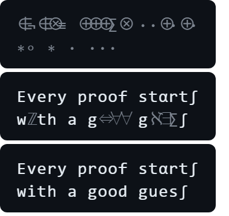

<div align="center">

# glyph-decode

**Give your README a title that decodes itself out of glyph noise, as one animated SVG.**

The decode wave from ascii-reveal and the math glyphs from mathglyph, in a file GitHub can play. No React, no JavaScript, no build step.

Works with **Claude Code** and **Codex**.

 


<sub>Real output of <code>python glyph_decode.py --demo</code>. It is an SVG, so it animates right here.</sub>

</div>

## Quick start
```bash
git clone https://github.com/Dodai0419/glyph-decode && cd glyph-decode
python glyph_decode.py "Your project name" -o header.svg
```
```text
wrote header.svg (2655 bytes)
```
Then put it at the top of your README:
```markdown
<p align="center"></p>
```

## The problem
- The best text-reveal effects this month (ascii-reveal, mathglyph) are React or DOM libraries. A GitHub README runs no JavaScript, so you cannot use them where people first see your project.
- Screen-recording the effect into a GIF gives a blurry, multi-megabyte file with fixed colors.
- Typing-effect SVG services need a third-party server in your README.

## The solution
| Idea | Fixes |
|------|-------|
| **Bake the decode wave into CSS keyframes** (same per-character timing and glyph ramps as ascii-reveal) | Plays in a README, on a docs site or in a slide with zero JavaScript |
| **One `<g>` per frame, one x per character** | Wide math symbols never push the line around; files stay 3-6 KB |
| **Five presets**: decode, dither, terminal, blueprint, math (mathglyph's look-alikes: E -> ∃, U -> ∪, R -> ℝ) | One command per look; `--rest` keeps a few math letters after landing |
| **Deterministic `--seed`** | The same command gives the same file, so diffs stay clean |

## Use with Claude Code
```bash
/plugin marketplace add Dodai0419/glyph-decode
/plugin install glyph-decode@glyph-decode
```
Then ask: *"Make an animated math-style header for this README."*

## Use with Codex (ChatGPT)
```bash
git clone https://github.com/Dodai0419/glyph-decode && cp -r glyph-decode/skills/* ~/.codex/skills/
```
Or copy `AGENTS.md` into your project root.

## Gallery
Every image below is a real file in `docs/`, made by `python glyph_decode.py --demo`.

**decode** (default): ASCII density ramp, then letters
```bash
python glyph_decode.py "glyph-decode\ntext that decodes itself" -o decode.svg
```


**math**: symbols from logic and set theory, with look-alike letters left at rest
```bash
python glyph_decode.py "Every proof starts\nwith a good guess" --preset math --rest 0.25 -o math.svg
```


**terminal**: block cursor, then binary-ish noise
```bash
python glyph_decode.py "$ ship --prod\ndeployed in 4.2s" --preset terminal -o terminal.svg
```


**dither**: shade blocks
```bash
python glyph_decode.py "Loading your dashboard" --preset dither -o dither.svg
```


**blueprint**: drafting marks in the accent color
```bash
python glyph_decode.py "SYSTEM DESIGN v2" --preset blueprint -o blueprint.svg
```


**Frame by frame** (the math SVG paused at 400 ms, 700 ms and 1200 ms in Edge):



## Options
| Flag | Default | What it does |
|---|---|---|
| `--preset` | `decode` | `decode`, `dither`, `terminal`, `blueprint`, `math` |
| `--speed` | `cinematic` | `fast` lands every letter within about 400 ms |
| `--theme` | `dark` | `light` for white pages |
| `--once` | off | Play once and stay on the text instead of looping |
| `--hold` | `2400` | ms to show the text before the next loop |
| `--rest` | `0` | Share of letters that stay as math look-alikes |
| `--play` | off | Preview the animation in your terminal |

`prefers-reduced-motion: reduce` shows the final text with no animation.

## Benchmarks
| | ascii-reveal | mathglyph | this repo |
|-|-|-|-|
| runs in a GitHub README | no (needs JS) | no (needs JS) | **yes** (CSS-only SVG) |
| JavaScript shipped to the viewer | ~15 KB gzip (their README) + React | 14.4 KB gzip core (their badge) | **0 KB** |
| source lines | 2,445 (TypeScript, `src/`) | not measured | 196 (Python, one file) |
| dependencies | React peer dep | none | none (Python stdlib) |
| time to make one header | not measured | not measured | 2.6-6.8 ms |
| output size | n/a | n/a | 3.0-6.2 KB per SVG |

Command: `python bench/bench.py` (20 runs per preset, 3 repeats). Windows 11, Python 3.11.1. Upstream sizes are quoted from their READMEs; upstream speed was not measured because it is a live browser effect, not a file generator.

## Inspired by
- [quanhoangindex/ascii-reveal](https://github.com/quanhoangindex/ascii-reveal) — the decode wave timing, per-character scramble schedule, hash and the four glyph presets (MIT).
- [8xb300/mathglyph](https://github.com/8xb300/mathglyph) — the math look-alike table and the "readable at rest" idea (MIT).

## Roadmap
- [ ] `--from-readme`: replace the first `# Heading` of a README with a decoding SVG.
- [ ] Gradient text and custom palettes.
- [ ] An `--avatar` mode that decodes a small image through the ASCII ramp.

## License
MIT. Includes adapted tables from ascii-reveal and mathglyph (both MIT); see LICENSE.
